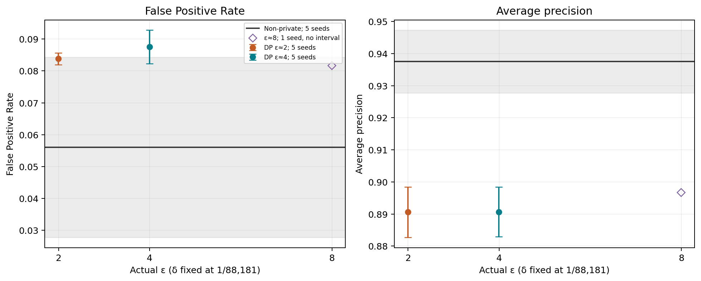
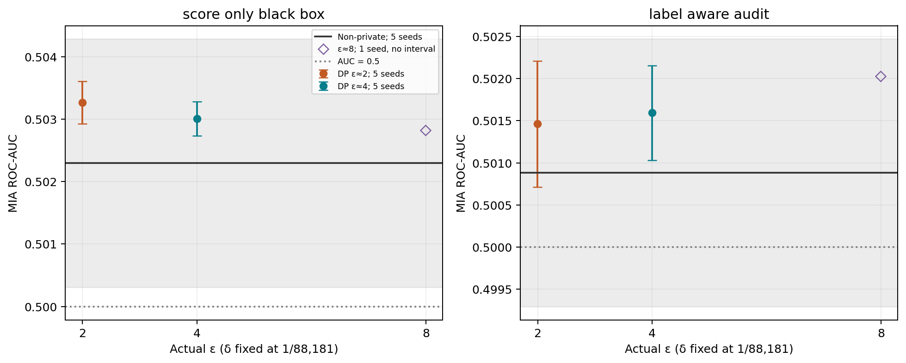
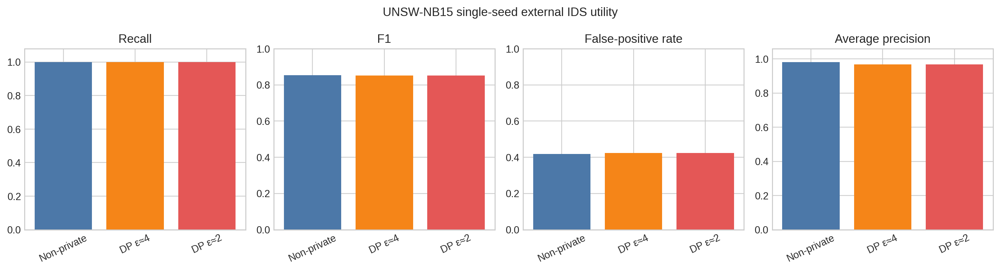
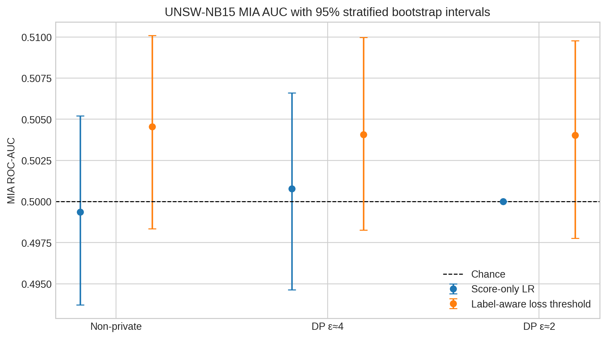

# Privacy–Utility Auditing of DP-SGD for Machine-Learning-Based Network Intrusion Detection

**Author:** Kazi Md. Tawsif Rahman  
**Affiliation:** [To be confirmed before submission]  
**Draft status:** methods and evidence revision, 2026-10-27; accepted results remain frozen 2026-09-14

## Abstract

Machine-learning-based network intrusion detection systems can expose information about their
training records, but privacy protection is useful only if detection performance remains
operationally meaningful. We evaluate this tension for a binary multilayer-perceptron intrusion
detector trained with and without formally accounted differentially private stochastic gradient
descent (DP-SGD). The primary study uses a locked NSL-KDD partition, five target-training seeds,
condition-matched shadow models, score-only black-box membership-inference attacks (MIAs)
and label-aware membership audits, validation-only F2 threshold selection, and a fixed KDDTest+ utility test. A
supplementary single-seed experiment repeats the main conditions on the official UNSW-NB15
training/testing partitions. On NSL-KDD, the non-private, epsilon-about-4, and epsilon-about-2
conditions achieve mean F1 scores of 0.8097, 0.8017, and 0.7946. Their false-positive rates are
0.0561, 0.0876, and 0.0838, and their average precisions are 0.9375, 0.8907, and 0.8906. The small
epsilon-about-4 Recall increase is uncertain across seeds; paired analyses instead show a higher
false-positive burden and lower average precision for both private conditions. Overall MIA AUCs
remain close to 0.5 for every condition, and all paired DP-minus-non-private AUC intervals cross
zero. On UNSW-NB15, private training similarly preserves selected-threshold F1 and near-perfect
Recall, but the operating points have approximately 42% false-positive rates and reduced average
precision. These results do not establish a DP-induced reduction in measured membership leakage.
The near-chance non-private results leave little observable room for improvement under the tested attacks. The formal DP
guarantee therefore remains the principal privacy evidence, conditional on fixed non-private
preprocessing, while the MIA results delimit what the tested attacks could measure. The study
contributes a reproducible evaluation design and a bounded negative result: under this protocol,
DP-SGD changes the operational utility profile without yielding a detectable improvement in
population-level membership inference.

**Keywords:** differential privacy; DP-SGD; intrusion detection; membership inference;
NSL-KDD; UNSW-NB15; privacy–utility tradeoff

## 1. Introduction

Machine-learning-based intrusion detection systems (IDSs) learn statistical patterns from network
traffic and can detect behavior not covered by a fixed signature database. Their training data may,
however, encode sensitive facts about hosts, users, communications, and recorded attacks. A model
can leak information about those records even when the original dataset is not released.
Membership inference formalizes one such risk: given a candidate record and access to a trained
model, an adversary tries to decide whether the record was part of the training set
[@shokri2017membership].

Differential privacy (DP) offers a distributional guarantee that limits the influence of one record
on a randomized algorithm’s output [@dwork2006calibrating]. For neural networks, DP-SGD applies
per-example gradient clipping, Gaussian noise, subsampling, and privacy-loss composition during
optimization [@abadi2016deep]. The guarantee is attractive because it does not depend on defeating
one chosen empirical attack. Yet DP-SGD can degrade predictive utility, and an IDS has asymmetric
operational costs: a false negative misses malicious activity, while a false positive consumes
analyst attention and may make a detector unusable. Accuracy alone cannot represent this tradeoff.

Empirical MIAs remain useful as audits of observable leakage, but interpreting them requires care.
Shadow-model attacks can learn behavioral differences between members and non-members
[@shokri2017membership], metric-based attacks can outperform poorly configured learned attacks
[@song2021systematic], and average-case metrics can hide leakage concentrated at low false-positive
rates [@carlini2022membership]. Recent work further shows that population-average or
defense-unaware evaluations can materially underestimate the most vulnerable records
[@aerni2024evaluations]. Consequently, a near-chance MIA result is evidence only about the stated
attacker and evaluation population; it is not proof that a model is private.

Existing privacy-preserving IDS studies establish that DP can be incorporated into network-traffic
classification, but they address different mechanisms and questions. Markovic et al. combine
federated random forests with a tree-specific exponential mechanism and report accuracy/F1 on
four IDS datasets, without a membership audit [@markovic2024random]. Liu et al. introduce a
feature-level Laplace-noise framework evaluated against membership and adversarial attacks on
USTC-TFC2016 and CICIDS2017 [@liu2025hierarchical]. Neither study is a centralized,
multi-seed DP-SGD evaluation with paired MIA uncertainty and IDS-specific operating metrics.

This paper asks:

- **RQ1:** How does formally accounted DP-SGD affect Recall, false-negative rate (FNR), F1,
  false-positive rate (FPR), and average precision for a fixed binary IDS pipeline?
- **RQ2:** Under the fixed score-only black-box MIA and label-aware audit protocols, is measured membership
  leakage lower for the private models than for a matched non-private model?
- **RQ3:** Does a constrained, single-seed UNSW-NB15 replication show the same broad
  privacy–utility pattern as the five-seed NSL-KDD study?

The contribution is not a new privacy mechanism and not a claim that DP is new to IDS. Instead,
we contribute: (1) a reproducible protocol combining formal accounting, IDS operating-point
selection, condition-matched shadow attacks, and paired uncertainty; (2) a five-seed NSL-KDD
analysis that reports false-alarm burden and ranking quality alongside Recall/FNR; (3) a bounded
single-seed external check on UNSW-NB15; and (4) an explicit negative finding that near-chance
baseline MIA limits the observable room for leakage reduction under the tested attacks.
These comparisons do not establish equivalence between private and non-private models.

## 2. Background and related work

### 2.1 Differential privacy and DP-SGD

A randomized mechanism \(M\) is \((\varepsilon,\delta)\)-differentially private if, for all adjacent
datasets \(D,D'\) differing in one record and all measurable output events \(S\),

\[
\Pr[M(D)\in S] \leq e^{\varepsilon}\Pr[M(D')\in S]+\delta.
\]

Smaller \(\varepsilon\) gives a tighter worst-case bound for fixed \(\delta\), but epsilon values are
meaningful only with the adjacency relation, training procedure, sampling assumption, and
accountant stated. DP-SGD clips each per-example gradient to a maximum norm and adds calibrated
Gaussian noise before the optimizer update [@abadi2016deep]. We use Opacus
[@yousefpour2021opacus] and its privacy-random-variable (PRV) accountant, which is based on
numerical composition of privacy-loss random variables [@gopi2021numerical].

Our formal statement covers the stochastic optimization stage. Categorical vocabularies, scaling
parameters, the model architecture, and hyperparameters are fixed outside the private optimizer.
We therefore do not claim end-to-end privacy for raw preprocessing. We also record
`secure_mode=False`; the runs support research evaluation, not a production-strength randomness
claim.

### 2.2 Membership inference as attack-relative evidence

The original black-box shadow-model formulation trains auxiliary models to generate member and
non-member examples for an attack classifier [@shokri2017membership]. Later studies show that
loss, confidence, correctness, entropy, and per-class calibration can be competitive or stronger
signals [@song2021systematic]. LiRA demonstrates that likelihood-ratio modeling and low-FPR
evaluation can uncover behavior hidden by aggregate accuracy or AUC [@carlini2022membership].
Canary-based auditing can also construct empirical lower bounds on a claimed DP guarantee, but
requires a different protocol from ordinary population MIAs [@steinke2023privacy].

Our study evaluates ordinary shadow-calibrated, population-level MIAs. We report ROC-AUC,
advantage, balanced accuracy, and TPR at 1% and 5% FPR. We do not run LiRA, RMIA, canary-based
worst-case auditing, label-only perturbation attacks, or a white-box adaptive adversary. The result
therefore answers RQ2 only under the stated attacks; it does not empirically certify the claimed
epsilon or rule out leakage from individual vulnerable samples [@aerni2024evaluations].

### 2.3 Privacy-preserving and adversarially robust IDS

Markovic et al. evaluate differentially private random forests in a horizontal federated-learning
framework on KDD, NSL-KDD, UNSW-NB15, and CIC-IDS-2017. Their exponential-mechanism
trees use epsilon values 0.1, 0.5, 1, and 5, and the evaluation reports accuracy and F1 for attack
detection and classification [@markovic2024random]. The work demonstrates a DP–IDS utility
tradeoff with public code, but does not evaluate membership inference and is not directly
comparable to centralized DP-SGD.

Liu et al. explicitly combine membership-inference and adversarial-attack defense. Their
HierarchicalDP framework ranks structured input features and applies different Laplace noise to
privacy- or category-sensitive features. It is evaluated on USTC-TFC2016 and CICIDS2017 with
MPE and EMI membership attacks and NIFGSM/APGD evasion attacks [@liu2025hierarchical].
This is the closest integrated privacy/security neighbor, but it is a feature-perturbation method,
not private gradient training, and it reports membership-inference success rates rather than our
multi-seed paired AUC analysis.

Adversarial evasion is related but distinct from membership privacy. Tafreshian and Zhang use a
genetic algorithm intended to respect feature mutability, interdependence, and protocol constraints,
then combine adversarial training, balancing, feature engineering, ensemble learning, and tuning on
NSL-KDD and UNSW-NB15 [@tafreshian2025defensive]. Sharma and Chen systematically apply
white-box and black-box attacks to nine NSL-KDD classifiers, but note that practical feature masking
remains future work [@sharma2024systematic]. These studies motivate precise threat models; they do
not provide evidence that our DP-SGD models are robust to evasion. Adversarial robustness is outside
the present experimental scope.

## 3. Method

### 3.1 Datasets and locked partitions

The primary task is binary classification, with Attack as the positive class. NSL-KDD provides
125,973 records in `KDDTrain+` and 22,544 in `KDDTest+` [@tavallaee2009detailed]. A locked,
seed-42 partition of `KDDTrain+`, stratified by binary label and coarse attack family, assigns
88,181 records to target training, 12,597 to target validation, and 25,195 to the shadow pool.
`KDDTest+` is reserved for IDS utility evaluation; it is not used to fit model parameters,
calibrate attacks, or select an IDS threshold. The final study uses this same split for every
target-training seed, rather than drawing five independent dataset splits.

The supplementary study uses the official UNSW-NB15 training/testing CSV partitions
[@moustafa2015unsw]. The 175,341 training records are split, with seed 42 and binary-label/attack-family
stratification, into 122,738 target-training, 17,534 target-validation, and 35,069 shadow-pool records.
The 82,332 official test records are reserved for IDS utility. This study uses one target-training
seed and the same three conditions as the primary comparison. It is a descriptive external check,
not an equally powered replication. Dataset hashes and partition counts are preserved in the
repository manifests. NSL-KDD family diagnostics pool R2L and U2R as Rare attacks; these
diagnostics remain exploratory because of small samples and multiple comparisons.

### 3.2 Preprocessing and model

NSL-KDD uses its 41 traffic features, excluding labels and the supplied difficulty field.
`protocol_type`, `service`, and `flag` are one-hot encoded, with unseen categories ignored;
numeric features are min–max scaled. The target preprocessor is fitted only on target-training
records, produces 122 inputs, and is then fixed for validation, testing, and all target conditions.
Each shadow fits its own preprocessor on its own member subset, using the same transformation
definition. Thus shadow and target categorical vocabularies need not have identical dimensions.

UNSW-NB15 excludes `id`, `attack_cat`, and `label`, leaving 42 input features. Its categorical
features are `proto`, `service`, and `state`; they receive most-frequent imputation followed by
one-hot encoding with unseen categories ignored. Numeric features receive median imputation
and min–max scaling. The target-training-only fit produces 192 transformed inputs. Shadow
preprocessors are fitted on their corresponding shadow members only. These data-dependent
transformations are not differentially private; the accounting scope is specified below.

Both datasets use an input–64–32–1 MLP with ReLU hidden activations, one output logit, and no
batch normalization. All target conditions use Adam, 30 epochs, nominal batch size 256,
learning rate 0.001, weight decay 0.0001, and `BCEWithLogitsLoss`. Within a target seed, conditions
start from the same initial parameter state. The final epoch is evaluated; validation is used for
threshold selection, not early stopping. The non-private loader shuffles records into batches;
the private loader uses Poisson sampling. Consequently, this is a comparison of the implemented
non-private and private training procedures, not an ablation isolating Gaussian noise alone.

### 3.3 Private training and accounting

Private training uses Opacus with flat per-example gradient clipping at norm 1.0, Gaussian noise,
Poisson sampling, and the privacy-random-variable (PRV) accountant. Adam updates the parameters
using the privatized gradients; DP-SGD here denotes that clipping-and-noise procedure rather than
the choice of a plain-SGD optimizer. Noise multipliers are chosen with `make_private_with_epsilon`,
and actual epsilon is read from the accountant after training.

The main NSL-KDD conditions are non-private, target epsilon 4, and target epsilon 2, each evaluated
at target seeds 42, 52, 62, 72, and 82. Seed-42 results are imported from the accepted budget sweep;
the four remaining seeds are additional target fits. Epsilon about 8 remains single-seed context
and is not pooled into this analysis. At \(\delta=1/88181=1.1340311\times10^{-5}\), actual epsilons
are 3.998267 and 1.999038, with noise multipliers 0.6817627 and 0.8813477. The private target
sample rate is \(1/345\), with 345 scheduled updates per epoch and 10,350 over 30 epochs.

For UNSW-NB15, \(\delta=1/122738=8.147436\times10^{-6}\). Actual epsilons are 3.995481 and
1.995670, with noise multipliers 0.6497192 and 0.8190918. The private target sample rate is
\(1/480\), giving 14,400 scheduled updates. Poisson batch sizes fluctuate, so 256 is a nominal
loader setting, not a fixed private batch size. Private shadows match their condition's target
epsilon and fixed delta, using their own sample rates and noise multipliers.

The reported budgets apply per trained model to optimization conditional on the fixed
preprocessor and training configuration. They do not cover the data-dependent preprocessing,
the complete model-selection workflow, or the joint release of all trained models. Validation
records do not receive a training-membership guarantee from this accountant. The experiment
uses `secure_mode=False` and does not claim production-strength cryptographic randomness.

### 3.4 IDS operating-point evaluation

For each target, validation F2 is computed at thresholds 0.01 through 0.99 in steps of 0.01,
predicting Attack when the model probability is at least the threshold. F2 is
\(5PR/(4P+R)\), where \(P\) is precision and \(R\) is Recall. The highest F2 is selected,
with higher Recall as the next sorting criterion. The NSL-KDD implementation has no explicit
third tie-break; UNSW-NB15 explicitly chooses the lower threshold if both F2 and Recall tie.
The selected threshold is then applied to the fixed utility test partition, without test-based
retuning. Default-threshold (0.5) results are retained as diagnostics.

Recall is \(TP/(TP+FN)\), FNR is \(FN/(TP+FN)\), and FPR is \(FP/(FP+TN)\).
We also report precision, F1, and average precision (AP). The repository column `pr_auc` is
calculated with `average_precision_score`; it is AP, not trapezoidal area under the
precision–recall curve. AP is independent of the chosen decision threshold and complements
the operating-point metrics.

### 3.5 Membership-inference protocol

**Shadow construction and calibration.** Each condition has five shadows, with seeds 101, 202,
303, 404, and 505. Each seed independently splits the same shadow pool 50:50 into members and
non-members, stratified by binary label and attack family. Outputs from the first four shadows
train the learned attackers; outputs from shadow 505 calibrate operating thresholds. This is a
held-out shadow model, not a disjoint set of underlying traffic records: records recur across
shadow splits. The shadow pool remains disjoint from target training and target validation.
Shadows also train on fewer members than the target, which limits how closely their output
distributions can match those of the target.

**Target population.** NSL-KDD uses the same 12,597 sampled target-training members and
12,597 target-validation non-members for every condition and seed. Member/non-member counts
are matched within Normal, DoS, Probe, and Rare groups. UNSW-NB15 similarly matches by attack
family, using 17,534 members and 17,534 non-members. Thus these are balanced membership
evaluations, not estimates under an assumed deployment membership prevalence. Validation
records are non-members of parameter fitting, although they also select the IDS threshold.
Attacks query raw probabilities, not the thresholded IDS decisions.

**Threat models and fixed primary attacks.** The score-only black-box attacker receives the
predicted Attack probability. Its primary model is logistic regression on that single feature,
preceded by standardization, with balanced class weights and at most 1,000 iterations. The
label-aware audit additionally assumes the true binary class is known. Its primary membership
score is negative cross-entropy loss: higher values indicate predicted membership. It therefore
has more information than the score-only setting and is not presented as a score-only deployed-service
attack. Loss uses the probability assigned to the true class, clipped in code to
\([10^{-12},1-10^{-12}]\) before taking its logarithm.

For each attack, its operating threshold maximizes balanced accuracy on shadow 505 over the
unique values of 400 score quantiles from 0.001 to 0.999. The first maximizing candidate is
retained. No target score or membership label is used for attacker fitting, attack selection,
score-direction selection, or operating-threshold calibration. The condition-specific attackers
from the accepted NSL-KDD sweep are frozen across all five target seeds; five new shadows are
not trained for each target seed.

NSL-KDD secondary analysis chooses the highest shadow-calibration AUC within each condition
and threat model, with the original candidate order breaking ties. Candidates are a confidence
threshold, logistic regression, and random forest for score-only access, and a loss threshold,
logistic regression, and random forest for the label-aware audit. Learned score-only models use
Attack probability; learned label-aware models use loss and correctness at IDS threshold 0.5.
Random forests use 300 trees and minimum leaf size 5. These secondary selections are frozen
before the repeated-target analysis; UNSW-NB15 uses only the two fixed primary attack families.
This protocol is not described as a preregistered confirmatory study.

**Metrics.** We report MIA ROC-AUC, empirical advantage
\(\max_t[\mathrm{TPR}(t)-\mathrm{FPR}(t)]\), and balanced accuracy at the shadow-calibrated
operating threshold. Low-FPR TPR is the maximum TPR at an observed target ROC point whose
FPR is at most 0.01 or 0.05, without interpolation or randomized tie-breaking. Advantage and
low-FPR TPR are retrospective ROC summaries using target membership labels for evaluation;
their maximizing thresholds are not deployed or fed back into calibration. They should not be
confused with independently calibrated operating performance. Score ties can restrict the
attainable ROC points, including zero TPR under a low-FPR ceiling.

### 3.6 Statistical analysis

The primary NSL-KDD uncertainty unit is the target-training seed. Condition means and sample
standard deviations use five seeds. Two-sided 95% t intervals use four degrees of freedom;
DP-minus-non-private differences are computed within matched seeds before summarization.
These intervals condition on the fixed records, split, preprocessing, hyperparameters, and
attackers. They exclude record-resampling and shadow-retraining variation. The budget sweep
informed the repeated settings, and seed 42 is reused, so this is not independent confirmation
of a selected optimal budget.

The earlier single-seed NSL-KDD sweep uses 1,000 ordinary record-bootstrap replicates for MIA
AUC and advantage; comparisons resample identical record indices in both conditions. The
supplementary UNSW-NB15 study uses 1,000 membership-stratified bootstrap replicates, also
paired by record for differences. Both use the 2.5th and 97.5th percentiles. These record-level
intervals condition on fitted models and attackers and do not estimate training-seed variation.
We neither pool datasets nor treat record-bootstrap replicates as independent training runs.

Intervals are unadjusted across metrics, budgets, and attacks. Exploratory differences must be
interpreted with that multiplicity in mind. The exported t intervals are not truncated at zero
or one; boundary-crossing intervals for low-FPR rates indicate the limitations of this approximation.
An interval crossing zero does not establish equivalence or non-inferiority. No equivalence
margin or operationally acceptable false-alarm budget was prespecified.

## 4. Results

### 4.1 NSL-KDD utility

<!-- evidence:nsl-utility:start -->
| Condition | Actual epsilon | Recall | FNR | F1 | FPR | Average precision |
| --- | --- | --- | --- | --- | --- | --- |
| Non-private | — | 0.7093 ± 0.0222 | 0.2907 ± 0.0222 | 0.8097 ± 0.0161 | 0.0561 ± 0.0227 | 0.9375 ± 0.0079 |
| DP epsilon about 4 | 3.9983 | 0.7134 ± 0.0138 | 0.2866 ± 0.0138 | 0.8017 ± 0.0082 | 0.0876 ± 0.0042 | 0.8907 ± 0.0063 |
| DP epsilon about 2 | 1.9990 | 0.7011 ± 0.0116 | 0.2989 ± 0.0116 | 0.7946 ± 0.0074 | 0.0838 ± 0.0015 | 0.8906 ± 0.0063 |
<!-- evidence:nsl-utility:end -->

Values are mean ± standard deviation over five target seeds at validation-selected thresholds.

The epsilon-about-4 Recall difference from non-private is +0.00404 with a 95% paired t interval
[-0.01334, 0.02142]; its F1 difference is -0.00809 [-0.02241, 0.00622]. Neither establishes an
improvement or degradation across seeds. The operational costs are clearer: FPR increases by
0.03145 [0.00460, 0.05830], and average precision decreases by 0.04682
[-0.05462, -0.03903].

At epsilon about 2, Recall differs by -0.00826 [-0.03135, 0.01483] and F1 by -0.01514
[-0.03364, 0.00335], again uncertain. FPR increases by 0.02772 [0.00038, 0.05507], while average
precision decreases by 0.04693 [-0.05312, -0.04074]. Thus, neither private condition is a confirmed
Recall optimum, and both produce a worse false-alarm/ranking profile under this protocol.

*Figure 1. Validation-selected F2 operating points over five NSL-KDD target seeds. The epsilon-about-8
marker is single-seed context without an interval. False-positive and average-precision diagnostics
prevent selection by Recall alone.*

### 4.2 NSL-KDD membership inference

<!-- evidence:nsl-mia:start -->
| Condition | Threat model | AUC [95% CI] | Advantage [95% CI] |
| --- | --- | --- | --- |
| Non-private | Score-only | 0.50230 [0.50031, 0.50428] | 0.00941 [0.00633, 0.01250] |
| Non-private | Label-aware | 0.50088 [0.49929, 0.50247] | 0.00786 [0.00444, 0.01128] |
| DP epsilon about 4 | Score-only | 0.50301 [0.50273, 0.50328] | 0.01107 [0.00959, 0.01254] |
| DP epsilon about 4 | Label-aware | 0.50159 [0.50103, 0.50216] | 0.01097 [0.00985, 0.01210] |
| DP epsilon about 2 | Score-only | 0.50327 [0.50293, 0.50361] | 0.01145 [0.01048, 0.01241] |
| DP epsilon about 2 | Label-aware | 0.50146 [0.50071, 0.50221] | 0.01130 [0.01041, 0.01220] |
<!-- evidence:nsl-mia:end -->

AUC and advantage entries are five-seed means with unadjusted 95% t intervals. The following
operating metrics are five-seed means; balanced accuracy uses shadow-calibrated thresholds,
whereas low-FPR TPR uses the retrospective ROC definition in Section 3.5.

<!-- evidence:nsl-low-fpr:start -->
| Condition | Threat model | Balanced accuracy | TPR at 1% FPR | TPR at 5% FPR |
| --- | --- | --- | --- | --- |
| Non-private | Score-only | 0.500397 | 0.000286 | 0.005509 |
| Non-private | Label-aware | 0.501016 | 0.000000 | 0.000000 |
| DP epsilon about 4 | Score-only | 0.500929 | 0.000000 | 0.000000 |
| DP epsilon about 4 | Label-aware | 0.501445 | 0.000000 | 0.000000 |
| DP epsilon about 2 | Score-only | 0.501262 | 0.000000 | 0.000000 |
| DP epsilon about 2 | Label-aware | 0.500881 | 0.000000 | 0.000000 |
<!-- evidence:nsl-low-fpr:end -->

Zero low-FPR TPR means that the evaluated score ordering and its available ROC points did not
identify members within that false-positive ceiling. It is not a privacy guarantee. Complete
per-seed results and uncertainty summaries remain in the repository.

All values are close to chance in magnitude. Some conditional across-seed AUC intervals exclude
0.5 by a few thousandths, so it would be inaccurate to say that every NSL-KDD interval contains
chance. The more relevant leakage-reduction question is paired. For epsilon about 4, paired AUC
differences are +0.00071 [-0.00111, 0.00254] score-only and +0.00071
[-0.00094, 0.00236] label-aware. For epsilon about 2, they are +0.00097
[-0.00076, 0.00270] and +0.00058 [-0.00126, 0.00242]. All primary and secondary paired AUC
intervals cross zero. The paired AUC comparisons do not establish a reduction for either tested private condition.

The secondary epsilon-about-2 label-aware advantage increases by 0.00345
[0.00068, 0.00621]. This is a small exploratory result from a secondary attacker and does not show
a broad privacy degradation, but it reinforces that the evidence cannot be summarized as leakage
reduction.

*Figure 2. Fixed primary attacks with conditional five-seed t intervals. The epsilon-about-8 marker
is single-seed context without an interval. Near-chance magnitude is not proof that leakage is absent.*

### 4.3 Supplementary UNSW-NB15 check

<!-- evidence:unsw-utility:start -->
| Condition | Actual epsilon | Threshold | Recall | F1 | FPR | Average precision |
| --- | --- | --- | --- | --- | --- | --- |
| Non-private | — | 0.24 | 0.998831 | 0.853572 | 0.418432 | 0.981609 |
| DP epsilon about 4 | 3.995481 | 0.02 | 0.999846 | 0.852478 | 0.423784 | 0.968490 |
| DP epsilon about 2 | 1.995670 | 0.02 | 0.999890 | 0.852436 | 0.424000 | 0.967663 |
<!-- evidence:unsw-utility:end -->

At the selected F2 operating point, both private models retain F1 within 0.0012 of non-private and
slightly increase Recall. They also increase FPR by about 0.0054–0.0056 and reduce average
precision by about 0.0131–0.0139. More importantly, absolute FPR is approximately 42% for every
condition. At the default 0.5 threshold it remains 27.3% for non-private and 40.7% for the private
models. Near-perfect Recall therefore does not imply operational deployability.

Score-only MIA AUCs are 0.499363 [0.493715, 0.505200], 0.500772
[0.494636, 0.506606], and 0.500000 [0.500000, 0.500000]. Label-aware AUCs are 0.504553
[0.498349, 0.510101], 0.504064 [0.498273, 0.509983], and 0.504033
[0.497777, 0.509767]. Every interval contains chance. The epsilon-about-2 score-only attacker emits
constant scores; its zero advantage and separated paired advantage difference are a degenerate
measurement, not proof of absent leakage.

*Figure 3. Single-seed UNSW-NB15 utility at validation-selected F2 thresholds. The table and FPR
must accompany the high Recall values.*

*Figure 4. Single-seed UNSW-NB15 MIA AUC with record-level bootstrap intervals.*

## 5. Discussion

### 5.1 Answers to the research questions

**RQ1: DP-SGD changes the utility profile more clearly than it changes Recall.** Across five
NSL-KDD seeds, the epsilon-about-4 Recall gain is too uncertain to call an improvement, and the
epsilon-about-2 Recall change is also uncertain. Both private conditions have materially lower
average precision and higher FPR. The result illustrates why choosing a privacy budget from Recall
or FNR alone is unsafe. The F2 threshold moves the operating point toward attacks, especially for
private models whose selected thresholds are much lower, but it cannot restore ranking quality.

**RQ2: the evaluated attacks do not demonstrate DP-induced leakage reduction.** The non-private
model’s primary AUCs are already approximately 0.5. Private-model AUCs remain in the same narrow
range, and paired intervals cross zero. This is an empirical floor effect: an attack cannot show a
large reduction from a baseline it already fails to distinguish. The result does not conflict with
formal DP. The DP guarantee is worst-case and mechanism-based; the MIA is a finite, attack-relative
measurement. Conversely, a weak MIA cannot be used to claim privacy for the non-private model.

**RQ3: UNSW-NB15 is qualitatively consistent only at a broad level.** The supplementary study
again shows close selected-threshold F1/Recall, slightly worse private-model FPR and average
precision, and near-chance overall MIA. However, it has one target seed, different data and
preprocessing, and an exceptionally high absolute FPR. It supports a bounded consistency statement,
not a universal generalization or formal comparison between datasets.

### 5.2 What can be selected from the tested conditions?

No tested epsilon is a universal optimum. Epsilon about 4 provides the highest mean NSL-KDD
Recall, but the paired interval includes both benefit and harm; its higher FPR and lower average
precision are clearer. Epsilon about 2 gives a tighter formal bound but slightly lower mean F1 and
does not improve measured MIA. A deployment decision would need an explicit privacy valuation and
a false-alarm cost, neither of which the benchmark datasets provide. We therefore present descriptive tradeoffs among the tested conditions rather than an
established optimal frontier.

### 5.3 Implications for empirical privacy evaluation

The negative MIA result is scientifically useful. It demonstrates that adding a formal guarantee
does not ensure that a population-average audit will measure a difference. Stronger attacks may
reveal leakage that the present features and shadows miss, especially for individual vulnerable
records [@carlini2022membership; @aerni2024evaluations]. A future privacy audit should be motivated
by a specific claim: LiRA/RMIA for stronger population inference, canaries for an empirical lower
bound on DP, a label-only attack for restricted APIs, or an adaptive attack that knows the defense.
Running more attacks solely after observing null results would introduce selection bias.

### 5.4 Operational IDS implications

F2 selection encodes a preference for Recall, not a universal operational objective. On NSL-KDD,
the private models trade a modest threshold-specific Recall profile for roughly three additional
false positives per hundred normal records and a substantial decrease in average precision. On
UNSW-NB15, the selected points flag more than four in ten normal test records. These figures are
not deployment claims; they are evidence that a single aggregate score can hide an unacceptable
alert burden. Future deployment studies should select thresholds from explicit alert capacity and
cost, then validate under temporal and site shift.

## 6. Limitations and threats to validity

1. **Formal scope.** Budgets describe individual optimization runs conditional on fixed preprocessing.
   Data-dependent preprocessing, hyperparameter and model selection, validation-data protection, and
   composition across releases of multiple trained models are outside the stated guarantee.
2. **Research randomness.** `secure_mode=False` is recorded. The implementation is suitable for
   experimental comparison, not a production cryptographic claim.
3. **Attack coverage.** The primary attacks are score-only logistic regression and a label-aware
   loss threshold. LiRA, RMIA, canary/worst-case auditing, label-only attacks, white-box access,
   adaptive attacks, and auxiliary-information variation are absent.
4. **Baseline floor.** Near-chance non-private MIA leaves little measurable headroom. Failure to
   distinguish members under these attacks is not evidence that the non-private model is safe.
5. **Dataset age and realism.** NSL-KDD is an older derived benchmark. UNSW-NB15 is more recent
   but still a benchmark generated in a controlled environment. Neither establishes performance on
   live organizational traffic.
6. **External-validation power.** UNSW-NB15 has one target-training seed. Its bootstrap intervals
   condition on that fitted model and do not measure training variation.
7. **Model and task scope.** The primary claim concerns one MLP family and binary classification.
   It does not cover multiclass attribution, other architectures, online learning, federated learning,
   or other DP mechanisms.
8. **Operating policy.** F2 thresholding emphasizes Recall. Different costs or alert budgets could
   reorder the practical preference among models.
9. **Conditional inference.** Five-seed t intervals use one split and fixed attackers, omit shadow-retraining
   and record-sampling variation, and are unadjusted for multiple comparisons. Seed 42 is reused from
   the budget sweep. Subgroup and epsilon-about-8 findings remain exploratory/single-seed context.
10. **No adversarial-evasion evaluation.** DP and adversarial robustness can interact, but the
    present experiments do not test protocol-valid evasion or poisoning.
11. **Shadow transfer and attack capacity.** The calibration shadow is held out by model, not by traffic
    record. All shadows reuse one pool and train on fewer members than targets. Logistic regression
    on one probability has limited attack capacity. Near-chance results cannot establish that a
    stronger or better-matched attacker would fail.
12. **Training comparison.** Private training changes sampling and clips gradients as well as adding
    noise. The utility differences cannot be attributed to Gaussian noise alone.

## 7. Reproducibility and ethics

The repository records dataset hashes, split sizes, preprocessing manifests, model and attacker
configurations, privacy-accounting parameters, warning logs, per-seed summaries, paired analyses,
figures, and evidence manifests. Large model states and per-record score exports remain in the
canonical external evidence bundles; compact aggregate evidence and checksums are committed.
Experiment 08 performs analysis only and starts no training, threshold tuning, or attacker fitting.
Experiment 09 records all 18 target/shadow completions and verifies official dataset identities.

This work uses public benchmark network-traffic datasets and does not collect new human-subject
data. Nevertheless, membership inference is dual-use. The study reports aggregate attacks for
defensive evaluation, avoids releasing private real-world traffic, and does not claim that a weak
attack makes a model safe to deploy.

## 8. Conclusion

We evaluated non-private and formally accounted DP-SGD training for a binary MLP IDS using a
five-seed NSL-KDD study and a single-seed UNSW-NB15 check. DP-SGD at epsilon about 4 and 2
retained broadly similar selected-threshold Recall/F1, but increased the false-positive burden and
reduced average precision. Population-level score-only and label-aware MIAs remained near chance,
and paired AUC comparisons did not show leakage reduction. The correct conclusion is therefore
bounded: the formal DP mechanism supplies privacy evidence conditional on fixed preprocessing,
while the tested MIAs reveal no measurable improvement over an already near-chance baseline.
Privacy budgets should not be chosen from Recall alone, and empirical attack failure should not be
confused with privacy certification.

## Appendix A. Supplementary UNSW-NB15 attack metrics

These entries complement the AUC results in Section 4.3. Advantage intervals are 95% percentile
bootstrap intervals conditional on the fitted target and attacker; balanced accuracy uses the
shadow-calibrated threshold. All rates are proportions. A positive lower interval for maximized
empirical advantage does not by itself establish leakage: maximization can yield a positive value
on finite samples even near chance, and these intervals are not a null-calibrated hypothesis test.

<!-- evidence:unsw-advantage:start -->
| Condition | Threat model | Advantage [95% CI] | Balanced accuracy |
| --- | --- | --- | --- |
| Non-private | Score-only | 0.006559 [0.001710, 0.017339] | 0.500713 |
| Non-private | Label-aware | 0.013346 [0.006730, 0.024243] | 0.501911 |
| DP epsilon about 4 | Score-only | 0.009182 [0.003706, 0.019679] | 0.499857 |
| DP epsilon about 4 | Label-aware | 0.009353 [0.005301, 0.021217] | 0.502538 |
| DP epsilon about 2 | Score-only | 0.000000 [0.000000, 0.000000] | 0.500000 |
| DP epsilon about 2 | Label-aware | 0.009068 [0.005133, 0.020707] | 0.502766 |
<!-- evidence:unsw-advantage:end -->

<!-- evidence:unsw-low-fpr:start -->
| Condition | Threat model | TPR at 1% FPR | TPR at 5% FPR |
| --- | --- | --- | --- |
| Non-private | Score-only | 0.008327 | 0.048249 |
| Non-private | Label-aware | 0.008327 | 0.048249 |
| DP epsilon about 4 | Score-only | 0.007300 | 0.043744 |
| DP epsilon about 4 | Label-aware | 0.007756 | 0.047108 |
| DP epsilon about 2 | Score-only | 0.000000 | 0.000000 |
| DP epsilon about 2 | Label-aware | 0.008384 | 0.043858 |
<!-- evidence:unsw-low-fpr:end -->

The constant-score epsilon-about-2 score-only attacker yields zero advantage and zero low-FPR
TPR under the deterministic ROC convention. This degeneracy limits that audit rather than
establishing that the target cannot leak membership.

## References

Citation keys correspond to `references.bib`. The LaTeX version renders the bibliography
automatically. Before submission, export publisher BibTeX for a final metadata comparison and
adapt the manuscript to the selected venue’s citation style.

